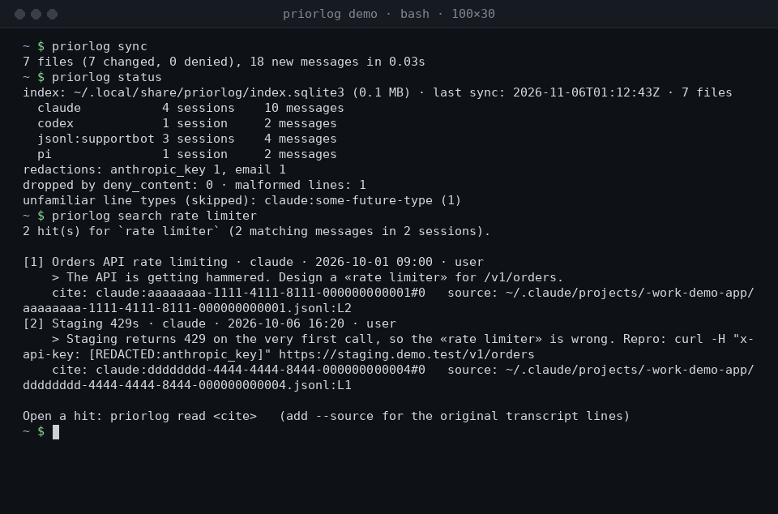
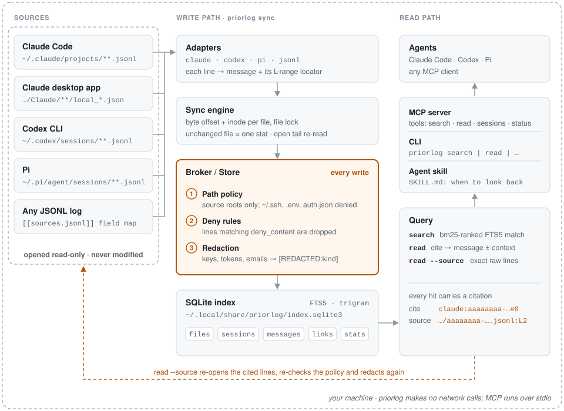
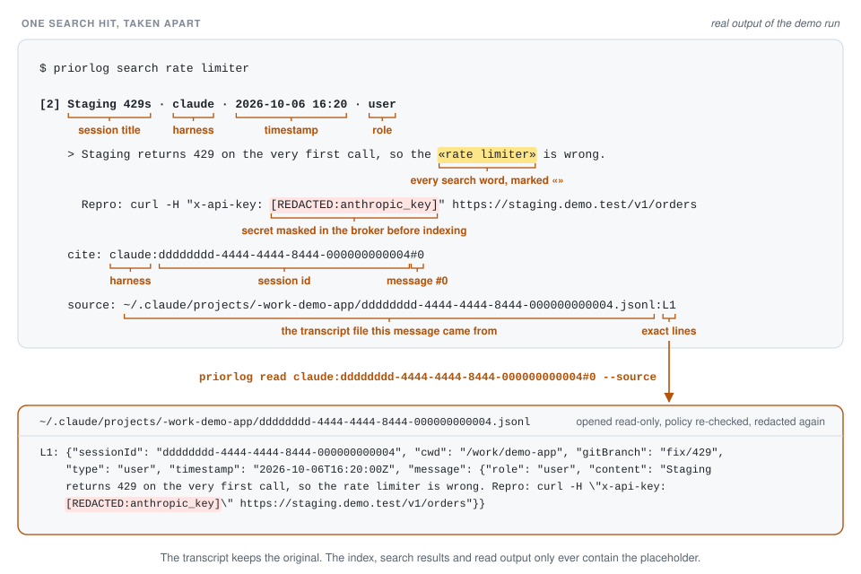

<p align="center">
  
</p>

# priorlog

**Local memory for coding agents.** priorlog indexes your past Claude Code, Codex CLI and Pi
sessions (plus any JSONL log you map) into one local search index. Secrets are redacted before
anything is stored. Your agents can then search what you already worked out, and every answer
comes back with a citation that opens the exact transcript lines.

It ships as an **MCP server**, a **CLI** and an **agent skill**. Nothing leaves your machine.

<p align="center">
  
</p>

```console
$ priorlog search rate limiter
[1] Orders API rate limiting · claude · 2026-10-01 09:00 · user
    > The API is getting hammered. Design a «rate limiter» for /v1/orders.
    cite: claude:aaaaaaaa-1111-4111-8111-000000000001#0   source: ~/.claude/projects/-work-demo-app/aaaaaaaa-….jsonl:L2
```

## Why

Coding agents forget everything between sessions, and the history they could use is spread
across tools that each store it differently. priorlog is built around three ideas:

- **Every harness, one index.** Claude Code (CLI transcripts, plus the desktop app's session
  titles), Codex CLI, Pi, and any JSONL log you describe in a few lines of config.
- **Redaction lives in the broker.** API keys, bearer tokens, private keys, emails and
  `KEY=value` secrets are masked inside the store, on every write and again when raw lines are
  read back. No adapter or client can skip it. Path deny rules stop credential files from ever
  being opened.
- **Citations, not vibes.** Each hit carries `session#message`, the harness, a timestamp and a
  `file:Lstart-Lend` locator. `read` opens the citation, and `read --source` shows the original
  lines, so an agent can show where a claim came from.

<picture>
  <source media="(prefers-color-scheme: dark)" srcset="assets/architecture-dark.svg">
  
</picture>

## Install

Requires Python 3.11+ on **Linux or macOS**.

```bash
uv tool install git+https://github.com/vulbsti/priorlog
```

`pipx install git+https://github.com/vulbsti/priorlog` works too. From a checkout, run
`uv tool install .`

## Quickstart

```bash
priorlog init      # writes ~/.config/priorlog/config.toml and shows which sources it found
priorlog sync      # indexes everything once; later syncs only read what changed
priorlog search "token bucket"
priorlog read <cite-from-search> --source
```

No transcripts on this machine yet? Try the bundled synthetic sample data from a checkout:

```bash
git clone https://github.com/vulbsti/priorlog && cd priorlog
export PRIORLOG_CONFIG="$PWD/examples/demo/config.toml" PRIORLOG_HOME="$(mktemp -d)"
priorlog sync && priorlog search rate limiter
priorlog read claude:aaaaaaaa-1111-4111-8111-000000000001#0 --source   # the cite search printed
priorlog status    # counts: 1 email redacted, 1 deliberately malformed line skipped
```

The two variables only last for that shell (and anything started from it). A new terminal, or
an MCP server your agent launches, uses your real (possibly empty) index. Remove the temp folder
(`$PRIORLOG_HOME`) when you are done. `priorlog search` exits with code 3 when nothing matches,
which is handy in scripts.

Connect it to your agents. priorlog prints these commands but never edits agent configs itself:

```bash
claude mcp add --scope user priorlog -- priorlog mcp
```

```bash
codex mcp add priorlog -- priorlog mcp
```

```bash
priorlog install-skill --target claude   # or: --target codex
```

The MCP server exposes `search`, `read`, `sessions` and `status`. Before a search or read, it runs
an incremental sync if the index is more than five minutes old, so you don't need a timer.
For Pi, which has no MCP, the skill tells the agent to use the CLI through its shell.

## What gets indexed

| Source | Default location | Notes |
| --- | --- | --- |
| Claude Code | `~/.claude/projects/**.jsonl` | Subagents become linked sessions. Resumed or forked sessions are de-duplicated. A multi-line assistant turn becomes one message with `[tool: Bash x3]` markers. |
| Claude desktop app | `~/.config/Claude/claude-code-sessions/*/*/local_*.json` (macOS: `~/Library/Application Support/Claude/...`) | Titles and `local_…` ids joined onto the CLI sessions. Cloud and Remote Control fields are ignored. |
| Codex CLI | `~/.codex/sessions/**/rollout-*.jsonl` | Injected `<environment_context>` and AGENTS.md blocks are dropped. Only your words and the agent's answers are kept. |
| Pi | `~/.pi/agent/sessions/**.jsonl` | Thinking blocks and tool output are not indexed. |
| Any JSONL | you choose | Map `text`, `role`, `session` and `timestamp` fields with dotted paths. See [configuration](docs/configuration.md#sourcesjsonl-repeatable). |

Tool outputs are never indexed. They are noisy and the most likely place for secrets.
`read --source` on an assistant turn does show the raw transcript lines in its range, which can
include tool calls and results. Those lines are redacted, deny-checked, and capped at 12 lines of
2,000 characters.

## Privacy and security model

- priorlog **only reads** transcript files, never modifies them, and writes only inside
  `~/.config/priorlog/` and `~/.local/share/priorlog/` (index mode `0600`), plus the skill folder
  when you run `install-skill`. A test runs the whole
  install flow in a throwaway `HOME` and checks that every other file is unchanged.
- **Redaction kinds:** private key blocks, Anthropic, OpenAI, GitHub, GitLab, AWS, Google, Slack,
  Stripe and Hugging Face tokens, JWTs, bearer and basic auth, credentials in URLs, cookies,
  `secret=`-style assignments, and emails. You can add your own regexes. High-entropy masking is
  available but off by default, because it also hides base64 data and long ids you may want to find.
- **Deny rules:** credential files (`.credentials.json`, `auth.json`, `.env` and `.env.*`, `~/.ssh`, keys, …)
  are never opened, even under a configured root. `deny_paths` adds globs, and `deny_content`
  drops whole messages that match a regex (for example a `PRIVATE:` convention).
- Every MCP result starts with a label saying that retrieved text is context, not instructions.
  The skill repeats this rule.
- Regex redaction can miss a secret format it doesn't know. See [SECURITY.md](SECURITY.md).

## Performance

Measured on 55,255 synthetic messages (1,647 transcript files, 347 MB of JSONL) on an 8-core laptop
(load average 2.4–2.7, medians of 3 runs):

| | |
| --- | --- |
| First full index | 21.8 s (~2,500 messages/s), 34 MB peak RSS, 214 MB index |
| Sync when nothing changed / after +600 messages | 151 ms / 799 ms |
| Search, in-process, p50 / p95 (360 mixed queries) | 19 ms / 123 ms |
| Specific queries (rare or mid-frequency terms, phrases), p50 | 11–15 ms |
| Very common words, or words under 3 letters, p50 | 86–119 ms (the slow case) |
| `priorlog search` from the shell, p50 (≈53 ms is Python start-up) | 78 ms |

Full method and numbers, including the slow cases: [docs/benchmarks.md](docs/benchmarks.md).

## Limitations

- Search is lexical (FTS5 trigram substring match). Words under 3 characters fall back to a
  slower scan. There is no semantic or embedding search yet.
- Redaction is pattern-based, so a secret in a format it doesn't recognise can get through
  (known gaps are listed in the [roadmap](docs/ROADMAP.md#near-term)).
  Rows that were already indexed are not changed when you add a redaction pattern, a
  `deny_content` rule or a `deny_paths` glob. Move the index away and run `priorlog sync` again
  to apply the new rule to old data.
- Transcripts you delete stay in the index until you rebuild it (`priorlog prune` is on the
  [roadmap](docs/ROADMAP.md)).
- Linux and macOS only (the sync lock uses `fcntl`).
- No access to cloud-only history (claude.ai/code cloud sessions). That is deliberate: priorlog
  reads local files and never uses your sign-in tokens.

## How a citation works

<picture>
  <source media="(prefers-color-scheme: dark)" srcset="assets/citation-anatomy-dark.svg">
  
</picture>

## Alternatives

Checked on 2026-11-05 by reading each project's source. The notes, with file-level evidence, are in
[docs/research/alternatives-2026-11-05.md](docs/research/alternatives-2026-11-05.md).

| | Harnesses | Search | Secret redaction | Agent access | Citation |
| --- | --- | --- | --- | --- | --- |
| **priorlog** | Claude Code (+ desktop titles), Codex, Pi, any mapped JSONL | SQLite FTS5 trigram | **In the store, before indexing**, and again on raw-line reads | MCP, CLI, skill | session#message + `file:Lstart-Lend` in the original transcript |
| [claude-devtools](https://github.com/matt1398/claude-devtools) | Claude Code | In-memory substring scan | None found | GUI only (Electron / web) | In-app only |
| [Claudescope](https://github.com/vladar107/claudescope) | 8 harnesses incl. Codex and pi | DuckDB BM25 | Opt-in, **output only**: the index and snippets hold raw text | MCP, CLI, web UI | session + message UUID |
| [episodic-memory](https://github.com/obra/episodic-memory) | Claude Code, Codex, Cursor, opencode, Oh My Pi | Local embeddings (sqlite-vec) + text | None found (has a DO-NOT-INDEX marker) | MCP, CLI | line range in its archived copy |
| [aichat search](https://github.com/pchalasani/claude-code-tools) | Claude Code, Codex | Tantivy BM25, one doc per session | None found | CLI/TUI + skill (no MCP) | session level |
| [sessiondex](https://github.com/windviki/sessiondex) | Claude Code, ZCode, Kimi, dsh, Qoder, opencode | SQLite FTS5 (CJK-aware) | None found | MCP, CLI, REST | session + message |

**Choose something else when:**
- you want **semantic** search ("that thing about flaky retries" without the right words). Use
  episodic-memory.
- you want a **GUI** with analytics and cost views. Use claude-devtools or Claudescope.
- you use harnesses priorlog doesn't read yet (Cursor, opencode, Copilot CLI, …). Claudescope and
  sessiondex cover more.

**priorlog's niche** is the combination: secrets masked before anything is stored, credential files
never opened, a JSONL mapping for logs that no tool knows about, Claude desktop-app titles, and
citations that point back at the original transcript lines.

## Docs

- [Usage: CLI, MCP and skill](docs/usage.md)
- [Configuration](docs/configuration.md)
- [Architecture](docs/architecture.md)
- [Benchmarks](docs/benchmarks.md)
- [Roadmap and good first issues](docs/ROADMAP.md)
- [Contributing](CONTRIBUTING.md) · [Agents working on this repo](AGENTS.md) · [Security](SECURITY.md)

## License

Apache-2.0. See [LICENSE](LICENSE).
