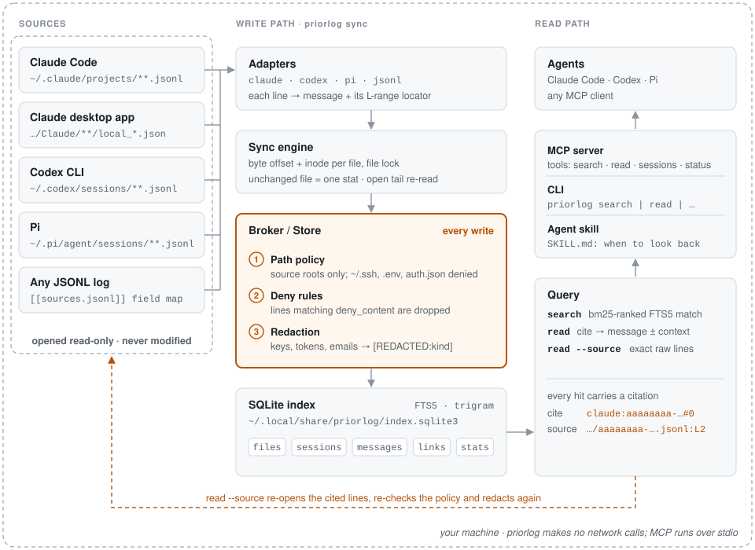

# Architecture

priorlog is a single Python package with no daemon. Every command (and every MCP tool call) loads
the config, optionally brings the index up to date, and answers from one SQLite file.

<picture>
  <source media="(prefers-color-scheme: dark)" srcset="../assets/architecture-dark.svg">
  
</picture>

## Components and data flow

```
transcript files (read-only)
  ~/.claude/projects, desktop local_*.json, ~/.codex/sessions, ~/.pi/agent/sessions, JSONL globs
        │
        ▼
 adapters/*.py      discover() lists files · parse(path, offset, line, carry) -> Batch
        │           (no writes, no DB access)
        ▼
 sync.py            file lock · policy check per file · offset/inode bookkeeping · tail re-read
        │
        ▼
 store.py (broker)  policy-approved batches only · redact every text field · drop deny_content
        │
        ▼
 SQLite index       meta · files · sessions · messages · fts (FTS5 trigram) · links · stats
        │
        ▼
 query.py           search · read (+ raw source lines, policy re-checked and redacted) · sessions · status
        │
        ▼
 render.py          markdown, context label  ──►  cli.py (terminal / --json)
                                               ──►  mcp_server.py (stdio tools)
```

| Module | Role |
| --- | --- |
| `config.py` | Finds and parses `config.toml` (or built-in defaults), resolves the data dir, holds `DEFAULT_DENY_PATHS`. |
| `policy.py` | Decides whether a path may be opened. Pure function of the config; no I/O beyond resolving the path. |
| `adapters/` | One per transcript format. Turn file lines into `Msg`, `SessionInfo` and links. |
| `sync.py` | Runs adapters over every configured source, incrementally, under a file lock. |
| `store.py` | The only code that writes to the database. Applies redaction and `deny_content`. |
| `redact.py` | Pattern-based masking to `[REDACTED:<kind>]`, with per-kind counts. |
| `query.py` | Read side. Returns plain dicts with citations. |
| `render.py` | Markdown shared by CLI and MCP; every MCP result is prefixed with the context label. |
| `cli.py`, `mcp_server.py` | Entry points. |

### Adapters

| Harness | Files discovered | Session id |
| --- | --- | --- |
| `claude` | `<root>/*/*.jsonl` and `<root>/*/*/subagents/agent-*.jsonl` | `claude:<uuid>`, subagents `claude:agent-<id>` |
| `claude` (desktop) | `<desktop_root>/*/*/local_*.json`, joined in `post_sync` | enriches `claude:<cliSessionId>` |
| `codex` | every `*.jsonl` under each root | `codex:<uuid from the file name or session_meta>` |
| `pi` | every `*.jsonl` under each root | `pi:<uuid>` |
| `jsonl:<name>` | files matching the configured globs | `jsonl:<name>:<session field, or file stem>` |

Each adapter keeps user text and assistant text. Consecutive assistant lines (text blocks and tool
calls) are merged into one message per turn by `TurnBuilder`, with tool calls reduced to markers
like `[tool: Bash x2]`. Tool outputs, reasoning/thinking and harness-injected context are not
indexed. Line types an adapter does not recognise are counted (shown by `priorlog status` as
"unfamiliar line types") and skipped.

Claude-specific handling: a resumed or forked session starts with a copy of its parent's lines,
still carrying the parent's `sessionId`. Lines naming another session that also has a file are
skipped and recorded as a `fork` link, so each message is stored once. Subagent transcripts become
their own sessions with a `subagent` link and `parent_id`. Desktop `local_*.json` files contribute
the desktop title (highest title rank), the desktop id (`local_...`), cwd and creation time; their
cloud and Remote Control fields are ignored.

## Incremental sync

`sync.sync()` takes an exclusive `fcntl.flock` on a lock file next to the index (the index path
with its suffix replaced by `.lock`, so `index.lock` by default). A CLI sync and an MCP auto-sync
therefore never interleave. Then, for each adapter: `discover()`, `prepare()`, and for every path:

1. **Policy.** If `Policy.allowed(path)` is false the file is counted as denied and never opened.
2. **Stat and compare** with the `files` row (`offset`, `line`, `inode`, `size`, `mtime`, `tail`):

   | Condition | Action |
   | --- | --- |
   | no row yet (`inode` is NULL) | parse from byte 0 |
   | inode changed, or size < stored offset (file replaced or truncated) | `reset_file`: delete that file's messages, reset offset/line/carry/tail, then parse from 0 |
   | size == stored offset and no open tail | unchanged: skip (costs one `stat`) |
   | size and mtime equal to the stored values | unchanged: skip (only a partial line or the open tail is pending, and nothing was appended) |
   | otherwise | resume from the stored position (see below) |

3. **Open tail.** Agents write an assistant turn one content block per line, so the last turn in a
   file may still be growing. `TurnBuilder.finish()` reports it as a `Tail` (its starting byte
   offset, line and the index of its first message). The store records the tail's session and
   first `seq` in `files.tail`. On the next sync `rewind_tail` deletes the messages from that
   `seq` on and resumes parsing at the tail's offset, so the turn is replaced rather than
   duplicated. The reported "new messages" count is net of the replaced ones.
4. **Complete lines only.** `iter_lines` yields only lines that end in `\n`; a half-written last
   line is left for the next sync. Lines over 32 MiB are skipped and counted as malformed.
5. **Carry.** Adapters return a small `carry` dict (stored as JSON in `files.carry`) for state
   that appears only early in a file, such as the Codex and Pi session id. It holds ids and
   offsets only, never text or paths, and its string values go through the same safe-id check
   as session ids.
6. **Apply.** `Store.apply` upserts sessions, assigns each message the next `seq` in its session,
   drops messages matching `deny_content`, redacts the rest, inserts links, updates the `files`
   row and bumps the counters. Each adapter's work is committed after its `post_sync`.

After all adapters, `meta.last_sync` / `meta.last_sync_epoch` are updated and unknown line types
are merged into `meta.unknown_types`.

**Auto-sync.** `maybe_sync()` runs a full sync when `index.auto_sync_seconds` is greater than 0 and
the last sync is at least that old. The CLI calls it before `search`, `read` and `sessions` (skip
with `--no-sync`); the MCP server calls it before every tool call. `priorlog status` on the CLI
never syncs. There is no timer or background process.

## Citations

Every search hit and every message returned by `read` carries:

| Field | Example | Meaning |
| --- | --- | --- |
| `cite` | `codex:cccccccc-3333-4333-8333-000000000003#1` | `<session id>#<seq>`; `seq` is the 0-based position of the message in its session |
| `session` | `codex:cccccccc-...` | harness-prefixed session id |
| `harness` | `codex` | `claude`, `codex`, `pi` or `jsonl:<name>` |
| `timestamp` | `2026-10-02T10:00:04Z` | time of the message as recorded by the harness (null if the source has none) |
| `locator` | `~/.codex/sessions/.../rollout-...jsonl:L7-L9` | transcript path (home shown as `~`) and the 1-based line range (`:L4` for a single line) |

`read <ref>` resolves the reference in this order: exact session id (with optional `#seq`); then,
for references of at least 6 characters, an exact native id, an exact desktop id (`local_...`) or a
native id prefix. Several matches produce an error listing them.

- With a cite, `read` shows the cited message (marked `▶`) and `--context` messages either side
  (default 4).
- With a session id, it pages through the whole session, about 24,000 characters per page.
- With `--source` and a cite, `query.raw_lines` re-opens the transcript, **re-checks the path
  policy** with the current config, reads lines `Lstart` to `Lend`, replaces any line matching
  `deny_content` with `[line withheld: matches a deny_content rule]`, redacts each line, cuts each
  line at 2,000 characters and shows at most 12 lines (then a note with how many more there are).
  If the file was deleted, or the current policy denies it, `read` returns an error instead.

## Search

The query is split on whitespace; `"double quoted phrases"` stay together. Every term must match.
Terms of 3 or more characters go to the FTS5 trigram index (`MATCH "a" AND "b"`), which gives
case-insensitive substring matching in any script: `deploy` finds `deployment`. Terms under 3
characters cannot use trigrams and fall back to a `LIKE` scan. Filters (`harness`, `project`,
`role`, `after`, `before`) are SQL conditions on the joined rows; `after`/`before` compare the
message timestamp (or the session start) as ISO strings.

Ranking uses FTS5 `bm25`, with messages of role `system` weighted down and newer messages first on
ties. At most two hits per session are returned, up to `limit` (default 10, max 100). Ranking,
the per-session cap (`ROW_NUMBER() OVER (PARTITION BY session)`) and the limit all run inside
SQLite, so only the returned rows and their text reach Python. Totals come from a separate
`COUNT`.

## Schema

One SQLite file (`index.sqlite3`), WAL mode, schema version 1 (in `meta`).

**`meta`** `(key TEXT PRIMARY KEY, value TEXT)`
Keys: `schema_version`, `last_sync` (ISO UTC), `last_sync_epoch`, `unknown_types` (JSON object of
`<harness>:<type>` to count).

**`files`** one row per transcript file seen.

| Column | Meaning |
| --- | --- |
| `id` | primary key |
| `path` | absolute path, unique |
| `harness` | adapter that owns it |
| `inode`, `size`, `mtime` | from the last sync's `stat` |
| `offset`, `line` | byte offset and line number the next sync starts from |
| `carry` | adapter state as JSON |
| `tail` | open tail as JSON: `{offset, line, session, seq}` |

**`sessions`** one row per conversation.

| Column | Meaning |
| --- | --- |
| `id` | `<harness>:<native id>` |
| `harness`, `native_id` | |
| `title`, `title_rank` | best title so far; a title replaces one of equal or lower rank (-1 none, 0 first indexed user message (set by the store, never from a denied message), 1 generated, 2 user-set or summary, 3 desktop app) |
| `cwd`, `branch` | working directory and git branch (cwd redacted like message text) |
| `started_at`, `ended_at` | only ever move earlier / later |
| `parent_id` | parent session for subagents |
| `desktop_id` | Claude desktop `local_...` id |
| `resume_cmd` | command to reopen the session in its harness (redacted) |
| `file_id` | first file the session was seen in |

**`messages`** redacted text plus its source location.

| Column | Meaning |
| --- | --- |
| `id` | primary key, also the FTS rowid |
| `session_id`, `seq` | unique together; `seq` is the citation number |
| `role` | `user`, `assistant` or `system` |
| `ts` | timestamp string from the source |
| `text` | redacted text |
| `file_id`, `line_start`, `line_end` | the citation locator |

**`fts`** `fts5(text, content='messages', content_rowid='id', tokenize='trigram')`, an external
content index kept in step by insert and delete triggers on `messages`. The exception is the first
sync into an empty index: `Store.begin_bulk()` drops both triggers, and `Store.end_bulk()` runs one
`INSERT INTO fts(fts) VALUES ('rebuild')` and recreates them. It does this in a `finally`, so the index
matches the table even if the sync fails. One rebuild is about 3x faster than per-row upkeep.

**`links`** `(from_id, to_id, kind)`, primary key on all three. Kinds: `subagent` (parent to
subagent) and `fork` (parent to the session that copied its history).

**`stats`** `(key, value INTEGER)` counters: `redacted:<kind>`, `dropped_by_deny_content`,
`malformed_lines`. Only counts are stored, never matched values.

## Security boundaries

| Boundary | Enforced in | Guarantee |
| --- | --- | --- |
| What may be opened | `policy.py`, called by `sync.py`, `ClaudeAdapter.post_sync` and `query.raw_lines` | A file is opened only if its resolved path is inside a configured root or matches a configured JSONL glob, and no deny glob matches it or any ancestor directory. Symlinks are resolved first. |
| What may be stored | `store.py` | Every message, title, cwd, branch and resume command is redacted (and dropped if it matches `deny_content`); messages matching `deny_content` are dropped. Adapters cannot write. |
| What may be shown | `query.raw_lines`, `render.py` | Raw lines are re-checked, filtered and redacted at read time; output is capped. MCP results carry the context label. |
| Where priorlog writes | `config.py`, `store.py`, `cli.py` | Only the config file, the data dir (index, WAL files, lock) and, on request, a skill directory. The index is created with mode `0600`. Enforced by `tests/test_isolation.py`. |
| Network | everywhere | None. The MCP server speaks stdio only. |

Raw transcript files are never modified. See [SECURITY.md](../SECURITY.md) for the threat model,
including what these boundaries do not cover.
